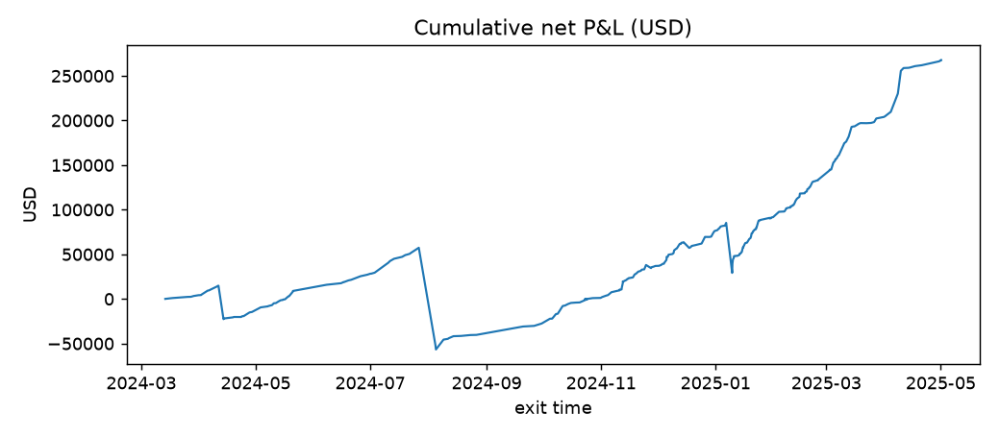
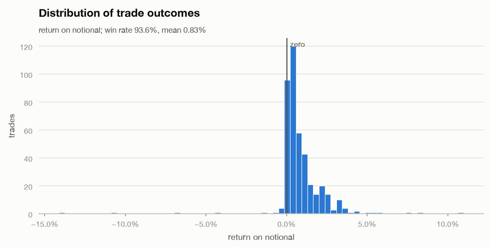
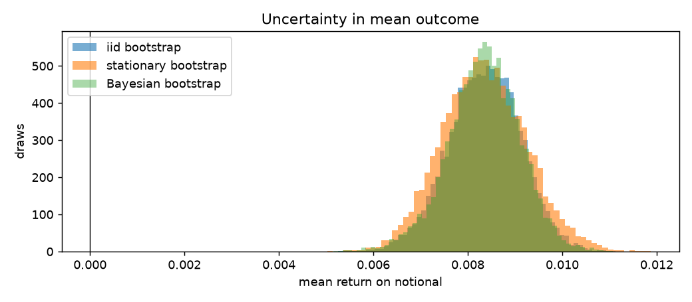
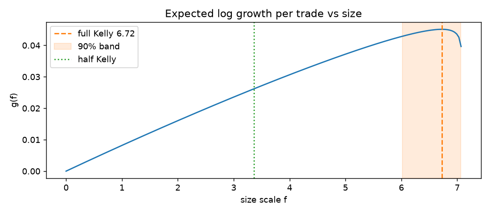

# trade-analytics

**Is there real skill in a discretionary trading record, and how much should be risked per trade?**

An independent quant research project that assesses a trading record the way a prop firm or fund
would assess a trader: expectancy, bootstrap and Bayesian inference on the edge, multiple-testing
control across slices, Probabilistic Sharpe Ratio, Monte Carlo drawdown and risk-of-ruin analysis,
and Kelly sizing under parameter uncertainty.

**Status:** in progress. The full pipeline runs end to end on a public **testing journal**
(422 BTC/ETH perpetual-futures trades reconstructed from public Hyperliquid fills). The same
pipeline will be run on a private personal journal.

## Headline results (testing journal)

| | |
|---|---|
| Trades / period | 422 / Mar 2024 - May 2025 |
| Win rate | 93.6% (payoff ratio 0.67 per unit notional; 0.15 in USD) |
| Mean return on notional | 0.83% per trade, 95% CI [0.66%, 1.02%] (stationary bootstrap) |
| Probabilistic Sharpe Ratio | > 0.999 (skew -1.9, kurtosis 35.8) |
| Loss concentration | 5 largest losses = 97.6% of all USD losses |
| Full Kelly leverage | 6.7x, against a 7.1x wipe-out bound set by the single worst trade |

The edge is statistically clear, but the record is a classic negatively skewed profile:
many small wins and a few large losses, concentrated in the largest positions. Full Kelly is
unusable here: it sits just below the leverage at which a repeat of the worst trade would wipe out
the account. Full results are [below](#full-results-testing-journal).
Write-up: [`docs/projects/pillar-1/PROJECT.md`](docs/projects/pillar-1/PROJECT.md).

## Full results (testing journal)

<!-- REPORT:START -->
<!-- Generated by scripts/run_report.py. Do not edit by hand. -->

Generated by trade-analytics. All numbers are reproducible from the input
journal and fixed random seeds.

- Trades: **422**
- Period: 2024-03-13 to 2025-05-01
- Instruments: BTC, ETH
- Outcome unit: **return on notional**

### 1. Descriptive statistics

| Statistic | Outcome unit | USD |
|---|---|---|
| Win rate | 93.60% | 93.60% |
| Average win | 0.99% | 1,233 |
| Average loss | -1.48% | -8,120 |
| Payoff ratio | 0.671 | 0.152 |
| Profit factor | 9.814 | 2.222 |
| Expectancy (mean) | 0.83% | 635 |
| Std dev | 1.57% | 6,781 |
| Total | 352.16% | 267,926 |




### 2. Is the edge distinguishable from zero?

| Method | Mean | 95% interval | one-sided p (mean <= 0) |
|---|---|---|---|
| iid bootstrap | 0.83% | [0.68%, 0.98%] | 0.0001 |
| stationary bootstrap (L = 7.5) | 0.83% | [0.66%, 1.02%] | 0.0001 |
| Bayesian bootstrap | 0.83% | [0.67%, 0.98%] | P(mean <= 0) = 0.0000 |



#### Sharpe-ratio statistics (per trade)

| Sharpe | SE (iid, Lo 2002) | Skew | Kurtosis | PSR (SR* = 0) | MinTRL (95%) |
|---|---|---|---|---|---|
| 0.530 | 0.052 | -1.87 | 35.82 | 1.0000 | 43.7 trades |

### 3. Bayesian win rate

- Posterior Beta(396, 28); mean 93.40%, 95% interval [90.85%, 95.56%]
- Breakeven win rate for payoff ratio 0.671: 59.85%
- P(true win rate > breakeven) = 1.0000

Partial pooling of win rates across instrument / direction:

| Slice | Trades | Raw win rate | Pooled win rate |
|---|---|---|---|
| BTC / long | 240 | 94.58% | 93.61% |
| BTC / short | 97 | 95.88% | 93.61% |
| ETH / long | 60 | 88.33% | 93.60% |
| ETH / short | 25 | 88.00% | 93.60% |

### 4. Which slices survive multiple-testing correction?

4 slices tested (one-sided t-test, H1: mean > 0).

| Slice | n | Mean | p | p (Holm) | p (BH) | Significant after Holm |
|---|---|---|---|---|---|---|
| BTC / long | 240 | 0.73% | 8.62e-24 | 3.448e-23 | 3.448e-23 | yes |
| BTC / short | 97 | 0.66% | 8.944e-15 | 2.683e-14 | 1.789e-14 | yes |
| ETH / long | 60 | 1.35% | 0.001544 | 0.001544 | 0.001544 | yes |
| ETH / short | 25 | 1.30% | 4.745e-05 | 9.491e-05 | 6.327e-05 | yes |

### 5. Position sizing (Kelly with parameter uncertainty)

Size scale f = leverage (notional / equity).

- Full Kelly (point estimate): **6.72**
- Posterior 5% / 50% / 95%: 6.02 / 6.82 / 7.06
- Posterior P(optimal size = 0): 0.0000
- Upper bound from worst trade (-14.12%): f < 7.08



### 6. Monte Carlo drawdowns and risk of ruin

10,000 iid resamples of the 422-trade sequence. Ruin = equity at or below
50% of the starting value at any point. Historical max drawdown at f = 1: 17.78%.

| f | Median final equity | Median max DD | 95th pct max DD | P(DD >= 20%) | P(DD >= 30%) | P(DD >= 50%) | P(ruin) |
|---|---|---|---|---|---|---|---|
| 1.00 | 32.1 | 14.1% | 21.1% | 6.7% | 0.1% | 0.0% | 0.0% |
| 1.68 | 316 | 23.7% | 34.5% | 66.2% | 9.7% | 0.0% | 0.0% |
| 2.00 | 906 | 28.2% | 40.7% | 86.1% | 17.5% | 0.4% | 0.0% |
| 3.00 | 2.22e+04 | 42.4% | 58.1% | 94.6% | 86.0% | 11.2% | 0.2% |
| 3.36 | 6.73e+04 | 47.4% | 63.8% | 94.6% | 86.3% | 17.4% | 0.4% |

<!-- REPORT:END -->

## Methods

| Module | Method |
|---|---|
| `ingest`, `cli` | Check and convert journals in any format to the canonical schema; `trade-journal` command |
| `loaders.hyperliquid` | Fill-to-round-trip reconstruction (scale-in/out, flips, gap detection) |
| `schema` | Canonical trade table and validation |
| `metrics` | Win rate, payoff ratio, profit factor, expectancy |
| `bootstrap` | iid and stationary block bootstrap (Efron 1979; Politis & Romano 1994) |
| `sharpe` | Sharpe SE (Lo 2002), PSR and MinTRL (Bailey & López de Prado 2012) |
| `bayes` | Beta-Binomial win rate, Bayesian bootstrap (Rubin 1981), partial pooling |
| `multiple_testing` | Holm (1979), Benjamini-Hochberg (1995), slice tests |
| `monte_carlo` | Trade-sequence resampling: drawdown distribution, risk of ruin |
| `sizing` | Kelly with Bayesian-bootstrap parameter uncertainty |
| `synthetic` | Generators with known answers for tests |
| `report` | End-to-end report with figures |

Every statistical method is tested against a known answer first (hand calculations, closed forms,
or synthetic data with a known true value). 55 tests.

## Data

- **Testing journal** (`data/testing_journal/`): derived from the public Kaggle dataset
  "Historical Trade Data" (Hyperliquid fills, CC0 1.0). See its
  [README](data/testing_journal/README.md) and [ADR-0004](docs/decisions/ADR-0004-testing-journal.md).
- **Personal journal**: never committed ([ADR-0001](docs/decisions/ADR-0001-private-trade-data.md)).

## Use your own journal

Any CSV journal can be checked, converted to the canonical schema and analysed:

```bash
uv run trade-journal check   my_journal.csv                    # is it already canonical?
uv run trade-journal convert my_journal.csv -o data/clean/journal.csv --dayfirst
uv run trade-journal analyse my_journal.csv -o reports/private/my_journal
```

Column names are matched automatically (e.g. `Symbol`, `Side`, `Open Time`, `P&L`, `Commission`).
Numbers like `$1,250.00` and `(320.50)`, day-first dates, signed sizes, gross P&L with costs,
R-multiple columns and stop prices are handled. Every mapping and derivation is written to a
conversion report, and invalid rows are listed by file line. For unusual files, generate a
mapping template, edit it, and pass it back:

```bash
uv run trade-journal convert my_journal.csv --write-mapping mapping.json
uv run trade-journal convert my_journal.csv --mapping mapping.json -o data/clean/journal.csv
```

Presets: `--preset mt4` (MetaTrader 4/5 history export). Examples:
[`examples/alien_journals/`](examples/alien_journals/). Design:
[`docs/design/journal-ingest.md`](docs/design/journal-ingest.md).
Outputs written under `data/`, `out/` and `reports/private/` are git-ignored.

## Run

```bash
uv sync --all-groups
uv run pytest
uv run python scripts/run_report.py      # regenerates the results section of this README
uv run trade-journal --help
```

To rebuild the testing journal from the raw Kaggle file:

```bash
uv run python scripts/build_testing_journal.py path/to/historical_data.csv
```

## Notebook

[`notebooks/pillar1_walkthrough.ipynb`](notebooks/pillar1_walkthrough.ipynb): the whole pipeline step by step on the
testing journal, with the reasoning behind each method and known-answer sanity checks. It is
executed by the test suite, so it always runs.

## Documentation

- [Project write-up](docs/projects/pillar-1/PROJECT.md)
- [Design docs](docs/design/)
- [Decision records](docs/decisions/)
- [Development log](docs/devlog/)
- [Learning notes](docs/learning/)
- [References](references.bib)
