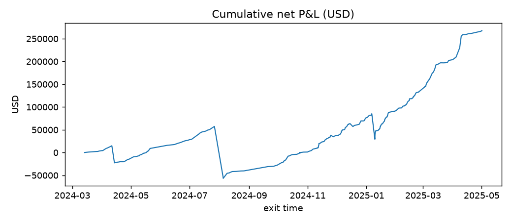
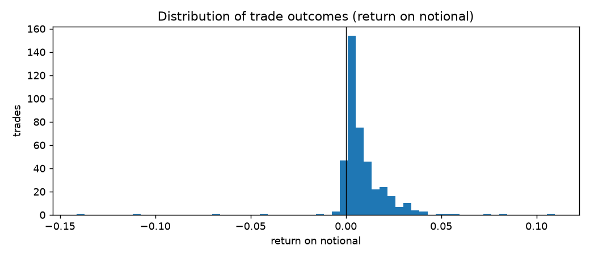
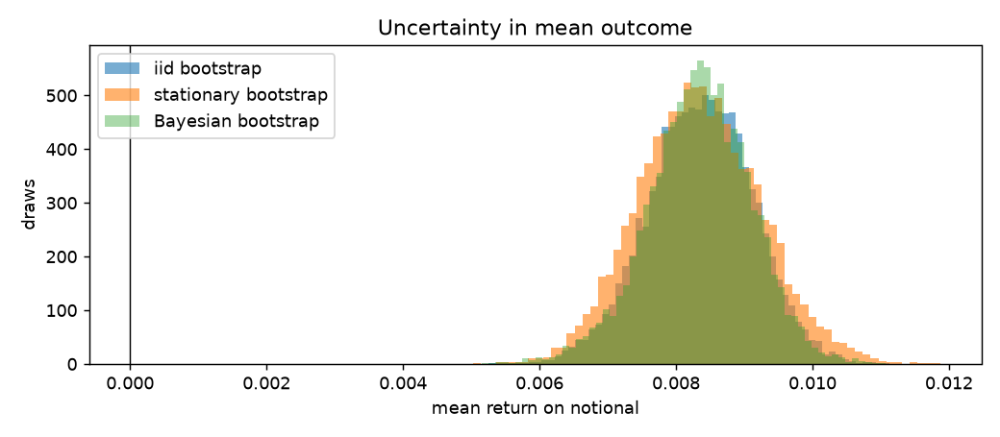
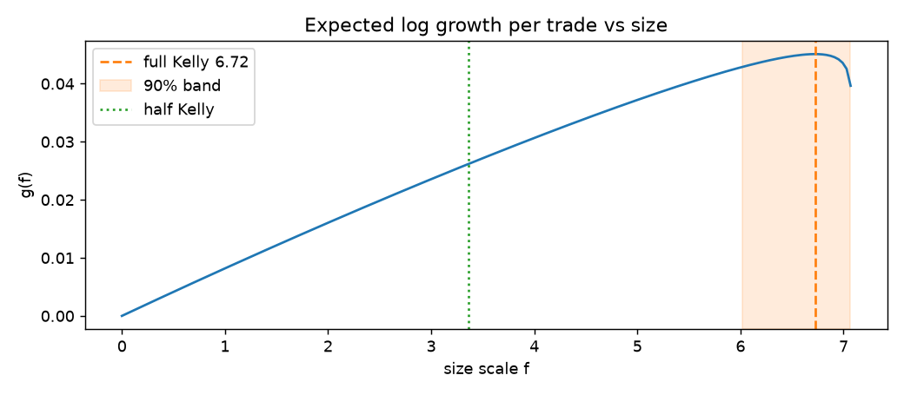

# Testing journal: statistical assessment

Generated by `scripts/run_report.py`. All numbers are reproducible from the
committed testing journal and fixed random seeds.

- Trades: **422**
- Period: 2024-03-13 to 2025-05-01
- Instruments: BTC, ETH
- Outcome unit: **return on notional**

## 1. Descriptive statistics

| Statistic | Outcome unit | USD |
|---|---|---|
| Win rate | 93.60% | 93.60% |
| Average win | 0.99% | 1,233 |
| Average loss | -1.48% | -8,120 |
| Payoff ratio | 0.671 | 0.152 |
| Profit factor | 9.814 | 2.222 |
| Expectancy (mean) | 0.83% | 635 |
| Std dev | 1.57% | 6,781 |
| Total | 352.16% | 267,926 |

## 2. Is the edge distinguishable from zero?

| Method | Mean | 95% interval | one-sided p (mean <= 0) |
|---|---|---|---|
| iid bootstrap | 0.83% | [0.68%, 0.98%] | 0.0001 |
| stationary bootstrap (L = 7.5) | 0.83% | [0.66%, 1.02%] | 0.0001 |
| Bayesian bootstrap | 0.83% | [0.67%, 0.98%] | P(mean <= 0) = 0.0000 |

### Sharpe-ratio statistics (per trade)

| Sharpe | SE (iid, Lo 2002) | Skew | Kurtosis | PSR (SR* = 0) | MinTRL (95%) |
|---|---|---|---|---|---|
| 0.530 | 0.052 | -1.87 | 35.82 | 1.0000 | 43.7 trades |

## 3. Bayesian win rate

- Posterior Beta(396, 28); mean 93.40%, 95% interval [90.85%, 95.56%]
- Breakeven win rate for payoff ratio 0.671: 59.85%
- P(true win rate > breakeven) = 1.0000

Partial pooling of win rates across instrument / direction:

| Slice | Trades | Raw win rate | Pooled win rate |
|---|---|---|---|
| BTC / long | 240 | 94.58% | 93.61% |
| BTC / short | 97 | 95.88% | 93.61% |
| ETH / long | 60 | 88.33% | 93.60% |
| ETH / short | 25 | 88.00% | 93.60% |

## 4. Which slices survive multiple-testing correction?

4 slices tested (one-sided t-test, H1: mean > 0).

| Slice | n | Mean | p | p (Holm) | p (BH) | Significant after Holm |
|---|---|---|---|---|---|---|
| BTC / long | 240 | 0.73% | 8.62e-24 | 3.448e-23 | 3.448e-23 | yes |
| BTC / short | 97 | 0.66% | 8.944e-15 | 2.683e-14 | 1.789e-14 | yes |
| ETH / long | 60 | 1.35% | 0.001544 | 0.001544 | 0.001544 | yes |
| ETH / short | 25 | 1.30% | 4.745e-05 | 9.491e-05 | 6.327e-05 | yes |

## 5. Position sizing (Kelly with parameter uncertainty)

Size scale f = leverage (notional / equity).

- Full Kelly (point estimate): **6.72**
- Posterior 5% / 50% / 95%: 6.02 / 6.82 / 7.06
- Posterior P(optimal size = 0): 0.0000
- Upper bound from worst trade (-14.12%): f < 7.08

## 6. Monte Carlo drawdowns and risk of ruin

10,000 iid resamples of the 422-trade sequence. Ruin = equity at or below
50% of the starting value at any point. Historical max drawdown at f = 1: 17.78%.

| f | Median final equity | Median max DD | 95th pct max DD | P(DD >= 20%) | P(DD >= 30%) | P(DD >= 50%) | P(ruin) |
|---|---|---|---|---|---|---|---|
| 1.00 | 32.1 | 14.1% | 21.1% | 6.7% | 0.1% | 0.0% | 0.0% |
| 1.68 | 316 | 23.7% | 34.5% | 66.2% | 9.7% | 0.0% | 0.0% |
| 2.00 | 906 | 28.2% | 40.7% | 86.1% | 17.5% | 0.4% | 0.0% |
| 3.00 | 2.22e+04 | 42.4% | 58.1% | 94.6% | 86.0% | 11.2% | 0.2% |
| 3.36 | 6.73e+04 | 47.4% | 63.8% | 94.6% | 86.3% | 17.4% | 0.4% |
